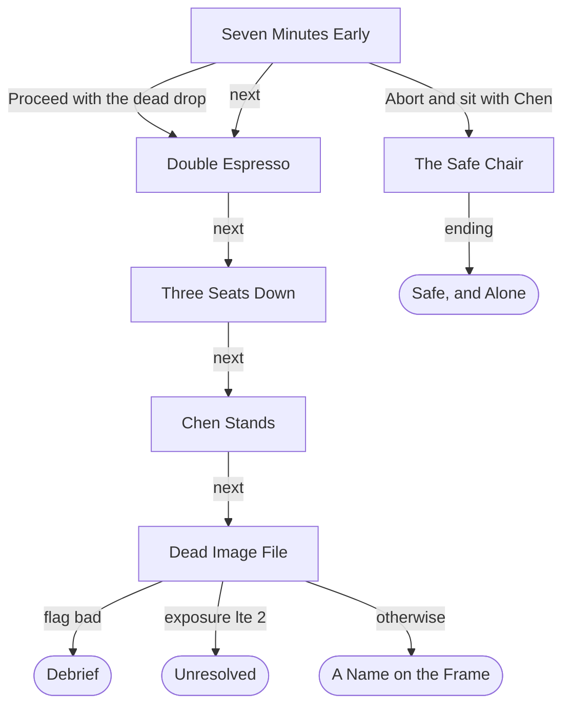

# Blueprint: The Dead Drop

Story file: `stories/dead_drop.json`. Worked example for the CTI 110 final project. It is a cut of a longer scene from *High Tech, Low Lives*. Copy the headings; replace the content with your own.

---

## 1. The pitch

A player who likes spy stories makes one secret pass in a cafe, under a camera and in front of their own lecturer, in about five minutes.

## 2. The lever

| | |
|---|---|
| Field | `role` |
| Set where | Scene `arrive`, group `role` (an `exec` choice) |
| Values | `enforcer` (might: chrome and muscle, through people and doors) and `hacker` (magic: code, through the feed and the locks) |
| What `enforcer` opens | `drop` / `pass` / `muscle`: palm the message past the camera, rolled with Body. `table` / `cover` / `rest`: rest the chrome hand between Chen and the cup. |
| What `hacker` opens | `drop` / `pass` / `loop`: loop the camera for six seconds, rolled with Code. `table` / `cover` / `ping`: ping Chen's tablet with a fake alert. |
| A lever that is also a number | Each choice also adds 3 to a stat meter (`body` or `code`). The roll reads that meter. |
| Why it matters | Two kinds of hero solve the same problem in two ways, and pay in different stress: the Enforcer in Systems, the Hacker in Nerves. |

## 3. User stories

**US-1. Choose how you work.**
As a player, I want to choose the Enforcer or the Hacker, so that the pass and the cover play differently.
Given I pick "The Hacker" at the start, When I reach "Make the pass?", Then I see "Loop the camera for six seconds" and not "Palm the message past the camera".
Check: checker line `OK lever: scene 'arrive' sets role to enforcer or hacker.` and `tests/dd_hacker_noticed.out`.

**US-2. Looking is free and pays off.**
As a player, I want looking at the cameras to open a safe path, so that careful play is rewarded.
Given I looked at the cameras, When I reach "Make the pass?", Then "Walk the blind line" shows, and it needs no roll.
Check: `tests/dd_enforcer_clean.out`.

**US-3. What I show the register follows me.**
As a player, I want the way I pay to change what the feed knows, so that a small choice has a cost later.
Given I show the Harker badge, When the drop works, Then I reach "A Name on the Frame" and the file names Sable Harker.
Check: `tests/dd_hacker_noticed.out` (seed 3 rolls a success).

**US-4. A failed roll changes the ending.**
As a player, I want a failed pass to have consequences, so that the dice matter.
Given I fail the pass roll, When I reach the phone, Then I go to "Debrief" whatever my Exposure is.
Check: `tests/dd_fail_debrief.out` (seed 2 rolls a fail) and checker line `OK shortest way to debrief (role enforcer): ... (needs fail)`.

**US-5. Walking away is a real choice.**
As a player, I want to be able to refuse the risk, so that playing it safe is a choice with its own ending.
Given I am at the start, When I pick "Abort and sit with Chen", Then I reach "Safe, and Alone" with no roll.
Check: `tests/dd_abort.out` and checker line `OK shortest way to aborted (role hacker): type 2 1 2 (3 picks)`.

(The save-file story is in `fort_blueprint.md`, US-5. Both stories use the same `s` and `l` keys on the same engine.)

## 4. The map

Scenes are boxes. Endings are rounded. The `phone` scene has a `route`: the first true condition wins.

The lever does not draw a new arrow here. It changes which options show inside `drop` and `table`, and the meters those options move. The route in `phone` then reads the result.

## 5. Scenes

| id | title | what happens | exits |
|---|---|---|---|
| `arrive` | Seven Minutes Early | The protocol. Manager Chen is already here. Choose Enforcer or Hacker. Look at the cameras, or not. Proceed or abort. | Proceed to `counter`; abort to `abort`; `next` counter |
| `counter` | Double Espresso | Pay with the student card (Exposure +1), coins (+0) or the Harker badge (+2). Sets `identity`. | `next` drop |
| `drop` | Three Seats Down | The pass. Enforcer: 4dF + Body vs 2. Hacker: 4dF + Code vs 2. With the camera cones: the blind line, no roll. | `next` table |
| `table` | Chen Stands | Chen talks to you. Her lines depend on `ok` or `bad`. Cover: talk about the exam, ping her tablet (Hacker) or rest the chrome hand (Enforcer). | `next` phone |
| `phone` | Dead Image File | g0's message. Its lines depend on the pass, the identity and the role. | `route`: `bad` to debrief; Exposure 2 or less to clean; else noticed |
| `abort` | The Safe Chair | Sit with Chen instead. The cup is cleared. | `ending` aborted |

## 6. Endings

| id | title | how you reach it |
|---|---|---|
| `clean` | Unresolved | The pass worked and Exposure is 2 or less. |
| `noticed` | A Name on the Frame | The pass worked and Exposure is 3 or more. The text names the identity you showed. |
| `debrief` | Debrief | The pass roll failed. |
| `aborted` | Safe, and Alone | Abort and sit with Chen at the start. |

## 7. State

| name | kind | set by | tested by |
|---|---|---|---|
| `role` | field | `arrive` / `role` / `enforcer` or `hacker` | `drop` beats 3 and 4; `drop` / `pass` / `muscle`, `loop`; `table` beats 14 and 15; `table` / `cover` / `ping`, `rest`; `phone` beats 10 and 11 |
| `identity` | field | `counter` / `pay` / `card`, `cash`, `badge` | `phone` beats 8 and 9; `noticed` beats 2 to 4 |
| `drop` | field | `arrive` / `approach` / `abort`; the pass results | Shown on the status line only |
| `exposure` | meter | `counter` / `pay`; the pass results; `table` / `cover` | `phone` route (`lte 2`) |
| `nerves` | meter | `loop` fail; `ping` | Shown on the status line only |
| `systems` | meter | `muscle` fail; `rest` | Shown on the status line only |
| `body` | meter (hidden) | `arrive` / `role` / `enforcer` (+3) | The `muscle` roll (`add: body`) |
| `code` | meter (hidden) | `arrive` / `role` / `hacker` (+3) | The `loop` roll (`add: code`) |
| `cones` | flag | `arrive` / `observe` / `cones` | `drop` beat 5; `drop` / `pass` / `blind` |
| `ok` | flag | `blind`; `muscle` and `loop` success | `table` and `phone` beats |
| `bad` | flag | `muscle` and `loop` fail | `table` and `phone` beats; `phone` route |

## 8. Cut list

| Item cut | Reason | Revisit when |
|---|---|---|
| `splitdrop` (the split-attention pass) | A second pass scene doubles the roll paths for one lesson. | You want a harder path with a difficulty of 3. |
| `invoke` (spend Fate on an aspect) | It needs the Fate economy. | The Fate economy comes back. |
| `change` (change the order and walk away) | It is a second way to quit at the start. `abort` already teaches that. | You want two different safe endings. |
| The Fate economy: the `fate` meter, compels, ties and success with style | This subset reads a roll as fail or success only. | Never in this format. The Stage plays the full version. |
| Endings `logged`, `burned`, `changed` | They belong to the cut scenes and the high-exposure branch. Four endings are enough to show a `route`. | You restore `splitdrop`, `change`, or a third exposure band. |

## 9. Definition of Done

- [x] `python3 checker.py stories/dead_drop.json` ends `RESULT: PASS`, and no warning comes from the story.
- [x] The checker shows 6 scenes and 4 endings.
- [x] Both roles reach all four endings.
- [x] Every user story has a check, and every check names a checker line or a golden run.
- [x] One golden run for each ending: `dd_enforcer_clean`, `dd_hacker_noticed`, `dd_fail_debrief`, `dd_abort`. Each roll run names its seed in the header.
- [x] `python3 tests/run_tests.py` ends `ALL TESTS PASSED`.
- [x] Story text is ASCII only. No profanity. Chen is "she".
- [ ] A classmate played it to two endings and signed the playtest form.

## 10. Sources and new inventions

| Part | Where it comes from |
|---|---|
| Scenes `arrive`, `counter`, `drop`, `table`, `phone`, `abort`; endings `clean`, `noticed`, `debrief`, `aborted`; their beats, trimmed | *High Tech, Low Lives*, PR #34, `arcade/stage/packs/dead-drop/script.json` at `97a8682`. |
| Meters `exposure`, `nerves`, `systems`; fields `identity`, `drop`; resolver `fate4df` | The same pack's `pack.json`. |
| The groups `observe`, `approach`, `pay` and the blind line | The same script. The blind line here needs no roll. |
| The Enforcer and the Hacker | HTLL `build/docs-v2/enforcer_playbook_v2.md` and `hacker_playbook_v2.md`. |
| **NEW, not canon:** the `role` group in `arrive` | Written for this unit. The original hero is the Infiltrator with Code +3 and no choice of role. |
| **NEW, not canon:** the `muscle` and `loop` options in `drop`, with their results | Written for this unit. The original has one "walk the camera line" roll. |
| **NEW, not canon:** the `cover` group in `table`, and the role lines in `drop`, `table` and `phone` | Written for this unit. |
| Changed | The `body` and `code` meters start at 0 and the lever adds 3. The `abort` sub says "Hold on to your cover". |
