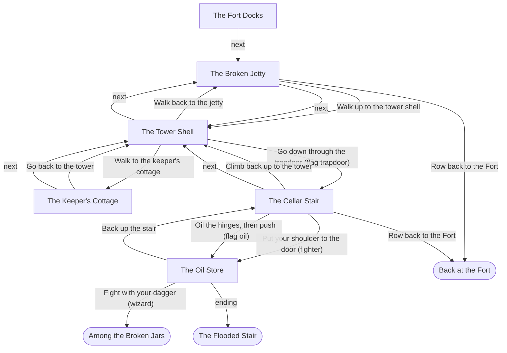

# Blueprint: The Drowned Tower

Story file: `stories/fort.json`. Worked example for the CTI 110 final project. Copy the headings; replace the content with your own.

---

## 1. The pitch

A first-time player rows to a ruined island, opens a stuck cellar door, and faces five giant rats, in about five minutes.

## 2. The lever

| | |
|---|---|
| Field | `role` |
| Set where | Scene `docks`, group `role` (an `exec` choice: it cannot be taken back) |
| Values | `fighter` (might) and `wizard` (magic) |
| What `fighter` opens | `cellar` / `door` / `shoulder`: put your shoulder to the door. `store` / `rats` / `fight`: hold the doorway. |
| What `wizard` opens | `cellar` / `door` / `force`: force the door (it fails and makes noise). `store` / `rats` / `sleep` and `dagger`. |
| Why it matters | The Fighter opens the door with muscle. The Wizard cannot. The Wizard has to look around first and find the oil in the cottage. Two heroes, two ways to play the same rooms. |

## 3. User stories

**US-1. Choose who goes.**
As a player, I want to choose the Fighter or the Wizard at the docks, so that the cellars play differently for each.
Given I am at the docks, When I pick "The Fighter", Then the stuck door shows "Put your shoulder to the door".
Check: checker line `OK lever: scene 'docks' sets role to fighter or wizard.` and `tests/fort_fighter_win.out`.

**US-2. Looking finds the way in.**
As a player, I want searching the tower to matter, so that looking around pays off.
Given I am in the tower shell, When I pick "Search the rubble", Then "Go down through the trapdoor" shows in the next question.
Check: `tests/fort_fighter_win.out`.

**US-3. A way past the door without muscle.**
As a player who chose the Wizard, I want a clever way past the stuck door, so that I can still reach the oil store.
Given I took the tin of lamp oil in the cottage, When I reach the stuck door, Then I can oil the hinges, and the rats have not heard me.
Check: `tests/fort_wizard_oil_win.out`.

**US-4. A bad choice costs something.**
As a player, I want a wrong choice to have a real cost, so that my choices feel like they count.
Given I am the Wizard in the oil store, When I pick "Fight with your dagger", Then I reach the ending "Among the Broken Jars".
Check: checker line `OK role wizard reaches: fell, flooded_stair, rowed_home` and `tests/fort_wizard_fell.out`.

**US-5. Save and come back.**
As a player, I want to save and load, so that I can stop and come back later.
Given I save at the cellar and quit, When I load, Then I am at the cellar with the same flags.
Check: `tests/fort_save_load.out` (save at the cellar, restart, load, then finish).

## 4. The map

Scenes are boxes. Endings are rounded. An edge with a condition in parentheses only shows when the condition is true.

Mermaid tip: put an edge label in double quotes when it holds parentheses or a comma. Without quotes, `(` breaks the diagram.

## 5. Scenes

| id | title | what happens | exits |
|---|---|---|---|
| `docks` | The Fort Docks | Captain Maren gives the job. The player picks the Fighter or the Wizard. | `next` jetty |
| `jetty` | The Broken Jetty | A fresh rope burn. A long shadow in the water. | Walk up to the tower; row home (ending `rowed_home`); `next` tower |
| `tower` | The Tower Shell | Search the rubble to find the trapdoor. Climb the stair to see the island. | Cottage; down the trapdoor (flag `trapdoor`); jetty; `next` jetty |
| `cottage` | The Keeper's Cottage | Week-old ash. A tin of lamp oil. A chalked eye with a line through it. | Back to the tower; `next` tower |
| `cellar` | The Cellar Stair | Listen at the stuck door. Open it: shoulder (Fighter), oil the hinges (flag `oil`), or force it (Wizard: it holds). | Shoulder or hinges to `store`; up to the tower; row home; `next` tower |
| `store` | The Oil Store | Five giant rats. Fight (Fighter) or Sleep (Wizard) clears them; the dagger fails; or back away. Then search the racks. | Dagger to ending `fell`; back to `cellar`; `ending` flooded_stair |

## 6. Endings

| id | title | how you reach it |
|---|---|---|
| `flooded_stair` | The Flooded Stair | Clear the rats (fight or Sleep), then search the racks or go on. The best ending. |
| `rowed_home` | Back at the Fort | Row home from the jetty or from the cellar stair. Safe, and nothing learned. |
| `fell` | Among the Broken Jars | The Wizard fights the rats with the dagger. |

## 7. State

| name | kind | set by | tested by |
|---|---|---|---|
| `role` | field | `docks` / `role` / `fighter` or `wizard` | `cellar` / `door` / `shoulder`, `force`; `store` / `rats` / `fight`, `sleep`, `dagger` |
| `trapdoor` | flag | `tower` / `look` / `search` | `tower` beat 3; `tower` / `look` / `search` (hides itself); `tower` / `go` / `down` |
| `oil` | flag | `cottage` / `look` / `oil` | `cottage` beat 3 and `cottage` / `look` / `oil` (hide the tin once taken); `cellar` / `door` / `hinges` |
| `noise` | flag | `cellar` / `door` / `force` | `cellar` beat 3; `store` beat 4 |
| `quiet` | flag | `cellar` / `door` / `hinges` | `store` beat 3 |
| `rats_gone` | flag | `store` / `rats` / `fight` or `sleep` | `store` / `loot` / `search` and `on` |
| `flasks` | flag | `store` / `loot` / `search` | `flooded_stair` beat 3 |

No meters. No dice.

## 8. Cut list

| Item cut | Reason | Revisit when |
|---|---|---|
| The torch clock (six turns of light) | A clock needs a meter that every move lowers. That doubles the number of states and the size of every golden run. | You add a `torch` meter and a `route` to a "torch gutters out" ending. |
| Wandering checks every second turn | They need dice and a turn counter. The example teaches the lever, not the clock. | After the torch clock. |
| Dice at the door (1-2 on a d6) and when listening (1-in-6) | Fort has no `roll`, so the lever shows clearly: the Fighter can, the Wizard cannot. | You want to teach `"resolver": "ose"`. |
| Hit points and the five-rat fight, round by round | A fight round by round is a loop inside a scene. This format has one choice per pick. | Never in this format. It is a good build feature in `game.py`. |
| The secret door on the landing | It leads to rooms past the first cellars. | Not in this unit. |
| Everything past the flooded stair | The example stays on the island and in the first cellars. | Not in this unit. |

## 9. Definition of Done

- [x] `python3 checker.py stories/fort.json` ends `RESULT: PASS`, and the only warning is the kit check (none from the story).
- [x] The checker shows 6 scenes and 3 endings.
- [x] The Fighter reaches `flooded_stair` and `rowed_home`. The Wizard reaches all three.
- [x] Every user story has a check, and every check names a checker line or a golden run.
- [x] One golden run for each ending: `fort_fighter_win`, `fort_wizard_oil_win`, `fort_wizard_fell`, `fort_rowed_home`. Plus `fort_save_load`.
- [x] `python3 tests/run_tests.py` ends `ALL TESTS PASSED`.
- [x] Story text is ASCII only.
- [x] `instructor/scan_fort_names.py` prints `no hits`.
- [ ] A classmate played it to two endings and signed the playtest form.

## 10. Sources and new inventions

| Part | Where it comes from |
|---|---|
| Room text for the docks, jetty, tower, cottage, cellar stair, oil store and flooded stair | Fort on the Lake repository, `classroom/python/stage2_choices.py`, `stage3_dungeon_clock.py`, `stage4_dice_functions.py`, `stage5_five_rats.py`, `stage6_rooms_as_data.py` (main `169ee8f`). |
| The Fighter and the Wizard (8 hp and a sword; 4 hp, a dagger and one Sleep spell) | The same classroom stages. |
| Oiling the hinges as the clever way past the stuck door | Fort repository, `dm/Module_2_The_Drowned_Tower.md`, C1 design note (lines 624-638). |
| **New:** the lever as a `role` field that hides and shows options | Written for this unit. |
| **New:** a few connecting lines: "One boat. One hero.", the trapdoor lifting, the chalk being fresh, the noise and quiet lines in the oil store, Maren's line in `rowed_home`, the `fell` ending text, the Sleep and dagger outcomes | Written for this unit, in the classroom stages' voice. |
| Not used | Anything from any published module. No names, room keys or read-aloud from outside the Fort repository's own text. Nothing past C3. |
